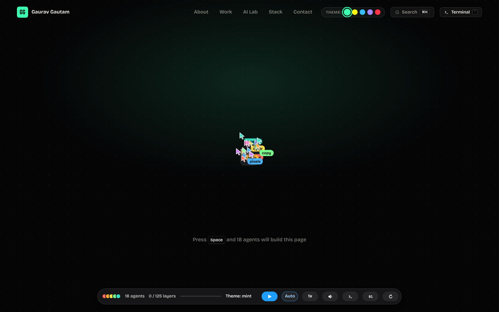

# Gaurav Gautam — Autonomous Cursor-Swarm Portfolio

<div align="center">

[](https://ggthedeveloper.github.io/MyPortfolio/)
[](https://github.com/ggthedeveloper)
[](https://www.linkedin.com/in/ggthedeveloper)
[](https://github.com/ggthedeveloper/VarshaPurvanumanAI)
[](https://github.com/ggthedeveloper)

<br/>

**A self-contained, 60-FPS interactive portfolio assembled live by an autonomous swarm of 18 multi-agent cursors.**

[Explore Live Demo](https://ggthedeveloper.github.io/MyPortfolio/) · [View Projects](#-featured-projects--research) · [Keyboard Shortcuts](#-keyboard-shortcuts) · [Quickstart](#-quickstart--local-preview)

<br/>



</div>

---

## ⚡ Highlights & Engineering Features

- **Interactive AI Research Lab (Transformer Pruning & Compression Simulator):**
  - An interactive in-browser research lab simulating **CoFi Structured Pruning** and **QA-LoRA (4-bit)** quantization for Transformer attention blocks (BERT/RoBERTa/LLaMA).
  - Drag the live sparsity slider ($0\% \to 80\%$) to watch 12 Attention Heads ($H_1 \dots H_{12}$) and 16 intermediate FFN channels dynamically mask in real time with audio feedback.
  - Live performance telemetry calculating **Retained Accuracy** (preserving $>95\%$ benchmark baseline), active parameters, VRAM memory reduction, and inference latency speedup.

- **Dropdown Hacker Terminal / Quake Console (<kbd>`</kbd> / <kbd>~</kbd>):**
  - Instant developer console featuring command line prompt `gaurav@portfolio:~$ `.
  - Built-in commands: `help`, `about`, `projects`, `lab`, `research`, `email`, `stats`, `theme <color>`, `matrix`, `clear`, and `exit` with typewriter effects and keystroke audio synthesis.

- **Cyber Matrix Rain Canvas Mode (<kbd>X</kbd>):**
  - Fullscreen cyberpunk falling Katakana/code rain stream reacting in real-time to the active accent theme palette.

- **3D Interactive Perspective Tilt & Specular Sheen:**
  - Project cards dynamically tilt in 3D space (`perspective(1000px) rotateX/rotateY`) following cursor physics, with an interactive radial light glare reflection.

- **1-Click Copy Email & Synthetic Audio Chime:**
  - Direct 1-click clipboard copy for `ggraipurchor@gmail.com` with toast notification and Web Audio API harmonic chime.

- **Autonomous 18-Cursor Swarm Engine:**
  - Upon loading or pressing <kbd>Space</kbd>, a swarm of 18 colored cursors (layout, type, color, copy, motion, pixels) concurrently draws wireframe boundaries and types text in real time using virtual-time choreographies.
  - Includes full playback telemetry: speed multiplier (<kbd>1</kbd>–<kbd>4</kbd>), auto-tour camera glide (<kbd>A</kbd>), audio synthesis (<kbd>M</kbd>), and instant replay (<kbd>R</kbd>).
  - Finale choreography: The swarm assembles at the footer to spell **`GAURAV`** → **`♥`** → **`BUILD`**.

- **Dynamic Accent Theme Switcher:**
  - Choose between 5 calibrated cyber palettes via the top navbar, mobile drawer, or keyboard shortcut (<kbd>C</kbd>):
    - 🟢 **Cyber Mint** (`#3dffb0`) — *Default*
    - 🟡 **Electric Yellow** (`#fff313`)
    - 🔵 **Neon Cyan** (`#38bdf8`)
    - 🟣 **Hyper Violet** (`#a58bff`)
    - 🔴 **Crimson Red** (`#ff3348`)
  - Preferences dynamically update CSS custom properties (`--acc`, `--on-acc`) and persist to `localStorage`.

- **Interactive Command Palette (<kbd>⌘K</kbd> / <kbd>Ctrl+K</kbd>):**
  - Instant spotlight search across sections, projects, research papers, external links, and color themes with fuzzy keyboard navigation (<kbd>↑</kbd>, <kbd>↓</kbd>, <kbd>↵</kbd>).

- **Project Category Filtering:**
  - Switch smoothly between project domains (**All**, **AI & Research**, **Systems & Optimization**, and **WebGL & Algorithms**) with animated transitions.

- **Fully Responsive Architecture:**
  - Designed with container queries and fluid typography clamp rules.
  - Desktop view features full navbar controls and quick theme swatches.
  - Mobile screens (≤ 760px) feature an animated hamburger menu with a frosted-glass slide-down drawer.

- **Zero-Dependency, Single-File Deployment:**
  - Entire application (HTML, CSS, WebGL canvas, Web Audio sound effects, and embedded WOFF2 fonts) is packaged in one self-contained `index.html` file.
  - Zero `node_modules`, zero bundlers, and zero external runtime requests.

---

## 🛠️ Featured Projects & Research

| Project | Domain | Stack | Links |
|---|---|---|---|
| **VarshaPurvanumanAI** | AI / Meteorology | PyTorch, FastAPI, React, Docker | [Live Demo ↗](https://varsha-purvanuman-ai.vercel.app/) · [GitHub ↗](https://github.com/ggthedeveloper/VarshaPurvanumanAI) |
| **RailSamanvayAI** | Optimization / Systems | Python, FastAPI, React, Docker | [Live Demo ↗](https://rail-samanvay-ai.vercel.app/) · [GitHub ↗](https://github.com/ggthedeveloper/RailSamanvayAI) |
| **Transformer Compression** | Deep Learning Research | PyTorch, CoFi Pruning, QA-LoRA, GLUE | [Research ↗](https://github.com/ggthedeveloper/MyPortfolio#research) · [GitHub ↗](https://github.com/ggthedeveloper) |
| **DrainSenseAI** | Geospatial ML | TreeSHAP, XGBoost, GIS, GeoPandas | [Overview ↗](https://github.com/ggthedeveloper/DrainSenseAI#overview) · [GitHub ↗](https://github.com/ggthedeveloper/DrainSenseAI) |
| **Smart Route Finder** | Graph Algorithms | OSMnx, NetworkX, Dijkstra, A*, Flask | [Live Demo ↗](https://smart-route-finder-n52n.onrender.com/) · [GitHub ↗](https://github.com/ggthedeveloper/Smart-Route-Finder) |
| **Space-Shooter-3D** | WebGL / Graphics | Three.js, WebGL, Web Audio API, Canvas | [Play Live ↗](https://ggthedeveloper.github.io/Space-Shooter-3D/) · [GitHub ↗](https://github.com/ggthedeveloper/Space-Shooter-3D) |

---

## ⌨️ Keyboard Shortcuts

| Key | Action |
|:---:|---|
| <kbd>Space</kbd> | Start or pause the cursor swarm construction |
| <kbd>1</kbd> / <kbd>2</kbd> / <kbd>3</kbd> / <kbd>4</kbd> | Adjust swarm playback speed (1×, 2×, 4×) |
| <kbd>A</kbd> | Toggle autopilot camera glide (auto-scroll through sections) |
| <kbd>C</kbd> | Cycle through accent color themes (Mint → Yellow → Cyan → Violet → Red) |
| <kbd>M</kbd> | Toggle Web Audio sound effects (wire tick, click, whoosh) |
| <kbd>R</kbd> | Replay swarm construction from the beginning |
| <kbd>⌘K</kbd> / <kbd>Ctrl+K</kbd> | Open the Command Palette search modal |
| <kbd>`</kbd> / <kbd>~</kbd> | Toggle Quake-style interactive hacker terminal |
| <kbd>X</kbd> | Toggle cyberpunk Matrix rain canvas stream |
| <kbd>Esc</kbd> | Close Command Palette, terminal, or mobile drawer |

---

## 🚀 Quickstart & Local Preview

Because this portfolio uses pure modern web standards, you can preview it instantly without compiling:

### Option 1: Python HTTP Server (Recommended)
```bash
python3 -m http.server 8085
```
Open **[http://localhost:8085](http://localhost:8085)** in your browser.

### Option 2: Node / npx
```bash
npx serve . -l 8085
```

### Option 3: Direct File Opening
Double-click `index.html` to open directly in Chrome, Safari, Firefox, or Edge.

---

## ⚙️ Customization Guide

All settings are localized inside `index.html` under the `CFG` configuration object:

```javascript
const CFG = {
  links: {
    github:    'https://github.com/ggthedeveloper',
    linkedin:  'https://www.linkedin.com/in/ggthedeveloper',
    email:     'ggraipurchor@gmail.com'
  },
  photo: '',                          // Leave empty to use embedded photo, or specify path
  agents: 18,                         // Number of autonomous cursors (default: 18)
  accent: 'mint',                     // Default theme: 'mint' | 'yellow' | 'cyan' | 'violet' | 'red'
  finale: ['GAURAV', '♥', 'BUILD'],   // Finale characters spelled by the swarm
  autostart: true,                    // Set true to start build automatically
  sound: true                         // Enable or disable synthesized audio
};
```

---

## 📁 Repository Structure

```
MyPortfolio/
├── index.html         # Complete, self-contained single-file portfolio (HTML, CSS, JS, Fonts, Assets)
├── gaurav.jpg         # High-resolution headshot
├── preview.png        # Screenshot preview for GitHub
└── README.md          # Comprehensive project documentation
```

---

## 👤 Author & Research Dossier

**Gaurav Gautam**
- **Institution:** SRM University-AP (B.Tech CSE with Minor in Mathematics, CGPA: **9.49**)
- **Fellowship:** Research Fellow at IIT Bhubaneswar (Efficient AI Lab)
- **Achievements:** 2× Smart India Hackathon Ministry Finalist (MoES & Ministry of Railways)
- **GitHub:** [@ggthedeveloper](https://github.com/ggthedeveloper)
- **LinkedIn:** [linkedin.com/in/ggthedeveloper](https://www.linkedin.com/in/ggthedeveloper)
- **Email:** [ggraipurchor@gmail.com](mailto:ggraipurchor@gmail.com)

---

## 📄 License

Open-source and available under the [MIT License](LICENSE).
